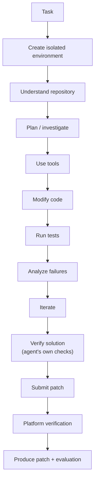
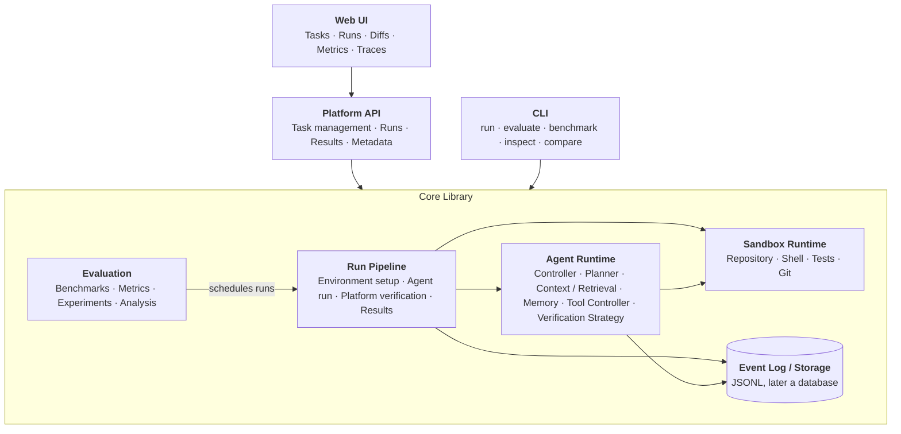
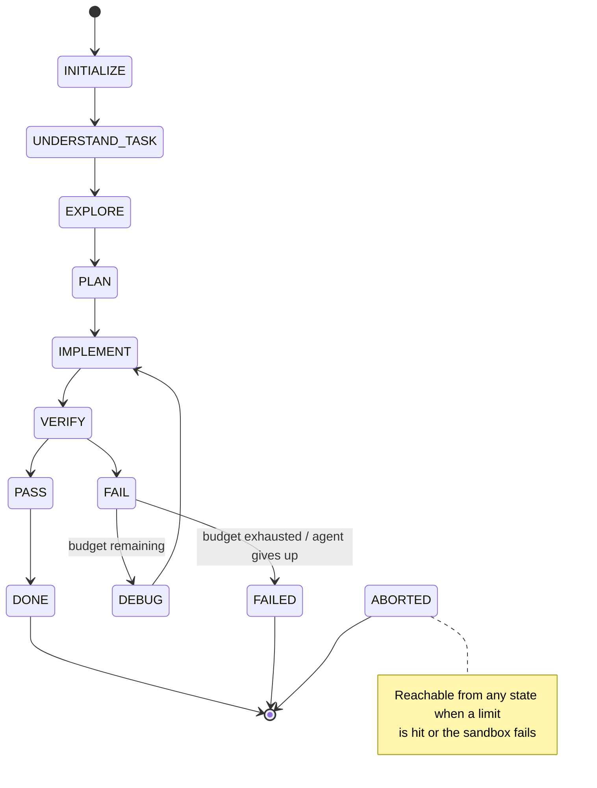
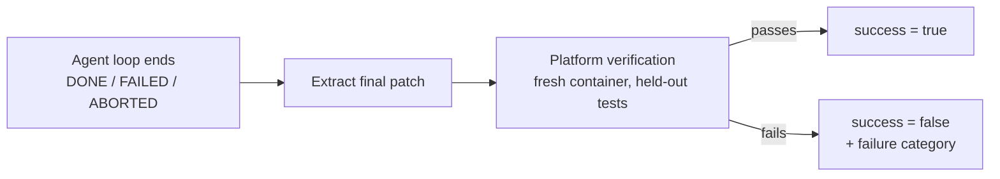
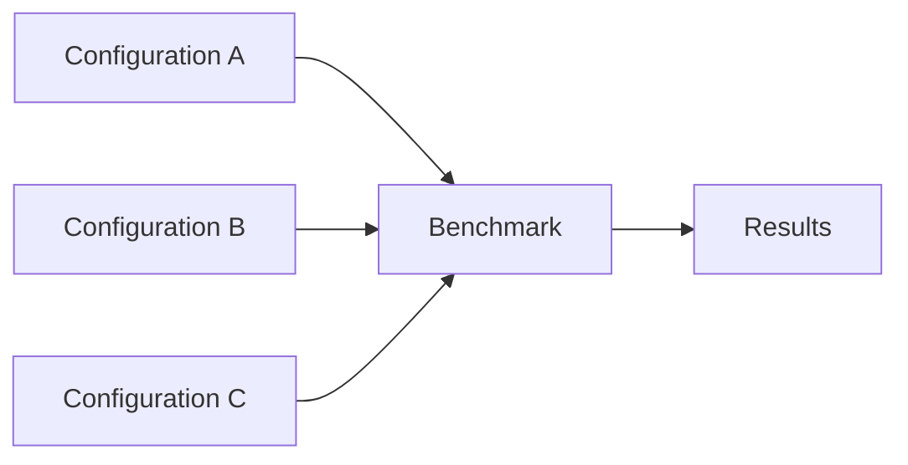
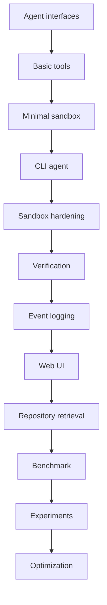
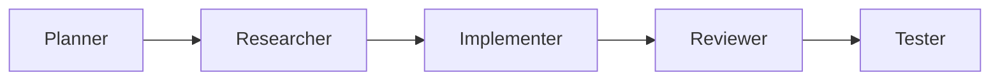
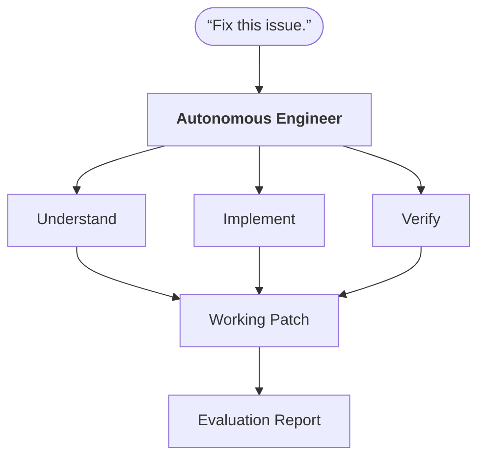

# Autonomous Software Engineer Platform

| | |
|---|---|
| **Status** | Proposed |
| **Owner** | Solo Developer |
| **Target** | Developer/research platform for autonomous software engineering |
| **Primary interface** | Web application + agent runtime + CLI (CLI first; the web UI arrives after the MVP) |
| **Initial deployment** | Local-first; cloud execution is a later extension (see [§27](#27-future-extensions)) |

## Table of Contents

1. [Product Overview](#1-product-overview)
2. [Problem](#2-problem)
3. [Goals](#3-goals)
4. [Non-Goals](#4-non-goals)
5. [Target Users](#5-target-users)
6. [Example User Stories](#6-example-user-stories)
7. [Product Architecture](#7-product-architecture)
8. [Agent Architecture](#8-agent-architecture)
9. [Tool System](#9-tool-system)
10. [Repository Context System](#10-repository-context-system)
11. [Sandbox](#11-sandbox)
12. [Verification System](#12-verification-system)
13. [Evaluation Platform](#13-evaluation-platform)
14. [Metrics](#14-metrics)
15. [Experiment System](#15-experiment-system)
16. [Web Application](#16-web-application)
17. [CLI](#17-cli)
18. [Technology Stack](#18-technology-stack)
19. [Data Model](#19-data-model)
20. [Implementation Plan](#20-implementation-plan)
21. [Recommended Development Order](#21-recommended-development-order)
22. [MVP Definition](#22-mvp-definition)
23. [V2 Definition](#23-v2-definition)
24. [Success Metrics](#24-success-metrics)
25. [Failure Taxonomy](#25-failure-taxonomy)
26. [Security Requirements](#26-security-requirements)
27. [Future Extensions](#27-future-extensions)
28. [Long-Term Product Vision](#28-long-term-product-vision)

---

## 1. Product Overview

The Autonomous Software Engineer Platform is a developer platform that allows users to give an AI agent real software-engineering tasks and observe it autonomously investigate, modify, test, and debug a codebase.

A user provides a GitHub repository and an issue or task. The platform creates an isolated execution environment, gives the agent access to the repository and a controlled set of development tools, and allows the agent to work toward a verified solution.

The platform has two related purposes:

- **Autonomous execution:** Give an agent an environment in which it can actually perform software-engineering work.
- **Evaluation:** Measure how well different agent architectures, models, tools, and strategies perform.

### Core Product Loop



---

## 2. Problem

Current LLM coding systems can generate code effectively in isolated examples, but real software engineering requires much more than code generation.

An autonomous engineer needs to:

- Understand an unfamiliar repository
- Locate relevant code
- Reason about dependencies
- Decide which tools to use
- Make changes safely
- Execute code
- Interpret compiler, test, and runtime failures
- Recover from incorrect approaches
- Determine when a task is actually complete

There is also a need for infrastructure that can systematically evaluate these behaviors. The platform addresses both needs (see [§1](#1-product-overview)): an environment in which an agent can do real engineering work, and the means to measure how well it does.

### 2.1 Existing Work and Build-vs-Reuse

Several open projects already cover parts of this space:

| Project | What it provides | Relevance here |
|---|---|---|
| SWE-bench (including its Lite and Verified subsets) | Real GitHub issues from Python repositories, each with a pinned commit, a per-task Docker environment and hidden tests, plus an evaluation harness | Candidate source of benchmark tasks, environments and verification ([§13](#13-evaluation-platform)); a cross-check on this platform's own verification |
| SWE-agent / mini-SWE-agent | Agent scaffolds for solving such issues (a fuller one and a deliberately minimal one) | Baseline configurations to compare against, and to sanity-check the platform |
| OpenHands | Open-source platform for software-engineering agents, with a sandboxed runtime and its own evaluation harness | The closest overall overlap; a candidate to reuse (runtime) or learn from |

These projects change quickly, so their current capabilities should be checked during the Phase 0 spike below.

**What is new here.** A basic agent loop is not novel. The value of this platform is the experiment layer:

- Swappable agent components behind stable interfaces
- Controlled, statistically sound comparisons across configurations
- Verification integrity (held-out tests, no feedback to the agent, history isolation)
- A failure taxonomy built on full execution traces
- An interface for inspecting individual runs

**Build vs. reuse.** Build where a component is itself the object of experimentation, or where reuse would limit control over interfaces, events or traces. Reuse where a component is a commodity.

- **Reuse (optional):** SWE-bench tasks and environment images as a stretch benchmark source (its prebuilt images target x86-64 and are large, so they are a poor fit for an Apple-silicon laptop), existing agent scaffolds as baselines, and possibly the SWE-bench harness as a cross-check on verification.
- **Build:** the agent runtime and its swappable components, the event schema and tracing, a thin sandbox layer over Docker, the evaluation and experiment layer, the verification-integrity mechanism, and the CLI and web UI.
- **Decide in Phase 0:** a one-day timeboxed spike on whether to adopt the SWE-bench harness or the OpenHands runtime for the sandbox layer instead of building it. The decision and its rationale go in the architecture document.

**Sanity check (optional).** Run an existing scaffold on a small subset (about 5 tasks) of SWE-bench Lite through this platform and compare the results with its published numbers. A large unexplained gap points to a bug in the platform's environments or verification, not in the agent.

---

## 3. Goals

### G1 — Autonomous Task Execution

Enable an AI agent to solve software-engineering tasks with minimal human intervention.

The agent should be capable of:

- Exploring repositories
- Searching code
- Reading files
- Editing files
- Running commands
- Running tests
- Inspecting Git state
- Diagnosing failures
- Iterating on its implementation

### G2 — Safe Execution

Run agent-generated commands and code inside isolated environments with controlled resources.

The system should prevent an agent from gaining unrestricted access to the host machine.

### G3 — Verifiable Outcomes

The platform should distinguish between:

> "The agent believes it solved the problem."

and:

> "The resulting repository passes the relevant verification."

Tests, builds, linters, or other configured validation mechanisms should determine success whenever possible.

Success is determined by verification that the **platform** runs on the agent's final patch (see [§12](#12-verification-system)), not by test runs the agent performs itself. The platform's verification results are never shown to the agent during a run.

### G4 — Reproducible Evaluation

Allow the same task to be executed repeatedly under controlled conditions.

Experiments should be reproducible across:

- Models
- Prompts
- Agent architectures
- Retrieval strategies
- Tool configurations
- Memory configurations

Because LLM behavior is non-deterministic, reproducibility requires recording and controlling:

- Pinned model versions
- Temperature and seed (where the provider supports them)
- Sandbox image digests
- A hash of the full agent configuration
- A configurable number of trials per task (1 for screening, 2–3 for final comparisons), with results reported alongside confidence intervals (see [§15](#15-experiment-system))

### G5 — Detailed Observability

Record enough information to understand why an agent succeeded or failed.

The platform should expose:

- Tool calls
- Command outputs
- Test results
- File modifications
- Diffs
- Execution time
- Token usage
- Estimated cost
- Failure and recovery events

### G6 — Extensible Architecture

Agent components should be replaceable without rewriting the entire platform.

Example:

```text
Agent
├── Model
├── Planner
├── Context Retriever
├── Memory
├── Tool System
└── Verification Strategy
```

---

## 4. Non-Goals

The initial product will **NOT** attempt to:

### NG1 — Replace Professional Software Engineers

This is an experimental autonomous engineering platform, not a production replacement for human development teams.

### NG2 — Support Every Programming Language

Initial support should focus on a limited set of environments, primarily:

- Python
- JavaScript / TypeScript

Additional languages can be added later.

### NG3 — Build a General-Purpose Consumer AI Assistant

The product is specifically focused on software-engineering tasks.

### NG4 — Train a Foundation Model

The platform will initially use existing LLM APIs and/or local models rather than training its own general-purpose model.

### NG5 — Build a Full IDE

The platform may provide code browsing and diff visualization, but replacing VS Code or another IDE is outside the initial scope.

### NG6 — Guarantee Arbitrary Task Completion

The system should provide reliable evaluation and transparent failure reporting rather than pretending every task can be solved.

### NG7 — Optimize for Production-Scale Infrastructure Initially

The first version should prioritize experimentation and correctness over massive distributed execution.

### NG8 — Large-Scale or Research-Grade Benchmarking Initially

The initial product targets small, exploratory experiments. Results are labeled exploratory rather than statistically conclusive, and benchmarks of hundreds of tasks are outside the initial scope.

---

## 5. Target Users

### Primary User

A developer or researcher experimenting with autonomous software-engineering agents.

They want to:

- Run agents against repositories
- Inspect their behavior
- Compare approaches
- Reproduce failures
- Measure improvements

### Secondary User

A developer who wants to delegate a well-defined software task to an autonomous agent and receive a patch.

---

## 6. Example User Stories

### US1 — Solve a Bug

As a developer, I want to provide a GitHub issue and repository so the agent can investigate and attempt a fix.

### US2 — Inspect an Execution

As a developer, I want to see every command, file modification, and test result produced by the agent.

### US3 — Compare Agents

As a researcher, I want to run the same benchmark against multiple agent configurations and compare success rates.

### US4 — Investigate Failure

As a researcher, I want to understand why an agent failed rather than seeing only a binary pass/fail result.

### US5 — Run Experiments

As a developer, I want to change one part of the agent architecture and evaluate whether it actually improves performance.

---

## 7. Product Architecture

The system has two front-ends (the web UI and the CLI), a thin Platform API, and a core library that contains all of the logic.



- The **CLI** and the **Platform API** are thin front-ends over the core library. In Phases 1–3 the CLI calls the core library directly; the API arrives in Phase 4.
- **Evaluation** orchestrates runs. It schedules them through the run pipeline and analyzes the results. It is not downstream of the sandbox.
- The **Run Pipeline** owns the lifecycle of a run: environment setup, the agent run, and then platform verification of the final patch ([§12](#12-verification-system)). Verification lives here, outside the Agent Runtime, so that the agent cannot influence it.

---

## 8. Agent Architecture

Each component below sits behind a stable interface, defined in Phase 0 ([§20](#20-implementation-plan)), so that it can be swapped without touching the rest of the platform (G6).

### 8.1 Agent Controller

The controller manages the agent's state machine.

Example state flow:



- `VERIFY` is the agent running its own, visible checks (for example, `run_tests`). Its results are advisory.
- If **PASS**: `DONE`
- If **FAIL** and budget remains: `DEBUG` → `IMPLEMENT` → `VERIFY`

**Terminal states (agent side):**

| State | Meaning |
|---|---|
| `DONE` | The agent declares the task complete and submits its patch. |
| `FAILED` | The agent's own checks are still failing and its iteration budget is exhausted, or the agent gave up. |
| `ABORTED` | The run was stopped by a limit (timeout, tool-call, token/cost) or by a sandbox error. |

None of these states means the task succeeded. When the agent loop ends, the run pipeline extracts the final patch and runs platform verification once ([§12](#12-verification-system)):



- `success` is recorded from the platform's verification result only. That result is never shown to the agent.
- Verification applies to every run that produced a patch, including `FAILED` and `ABORTED` runs. A run with an empty patch is recorded as unsuccessful without verification.
- Every run that is not verified successful, including one where the agent declared `DONE` but verification failed, is assigned a failure category (see [§25](#25-failure-taxonomy)).

The controller should enforce:

- Maximum iterations
- Maximum tool calls
- Execution timeout
- Token/cost limits
- Sandbox restrictions

### 8.2 Model Provider and Agent Loop

The model is accessed through the provider abstraction described in [§18](#18-technology-stack). Within each state, the controller drives a loop of *model call → tool call(s) → observation*.

Responsibilities:

- Prompt assembly
- Conversation history and context-window management (for example, truncating or summarizing old tool output)
- Token and cost accounting
- Token discipline, to keep contexts small enough for local models: a default `max_iterations` of 15–20, truncated tool output, line-range file reads, and summarization of old history

### 8.3 Planner

An optional component that produces an explicit plan before the `IMPLEMENT` state. When disabled, the agent proceeds directly from exploration to implementation. Direct execution and explicit planning are compared in Phase 7.

### 8.4 Context Retriever

The agent's interface to repository knowledge (see [§10](#10-repository-context-system)). Given a query, it returns relevant files, snippets, or symbols. Retrieval strategies (R1–R3) are interchangeable behind this interface.

### 8.5 Memory

Task-scoped working memory: notes, findings, and failed approaches retained within a single run. Persistent memory across runs is a future extension ([§27](#27-future-extensions)).

### 8.6 Tool Controller

Validates and dispatches tool calls ([§9](#9-tool-system)) into the sandbox, enforces the controller's limits, records every call and result as events, and returns structured results to the agent.

### 8.7 Verification Strategy

Decides *when* the agent runs tests during a task, such as a single final test versus iterative test-driven development (compared in Phase 7). Agent-run tests are feedback only; the authoritative verification is run by the platform ([§12](#12-verification-system)), and its results are never fed back to the agent.

---

## 9. Tool System

The initial tool set should be deliberately small. Parameters marked `?` are optional.

### Repository Tools

```text
list_files(path?, depth?)
read_file(path, start_line?, end_line?)
search_code(query, path?, glob?)
```

Added with R2 retrieval ([§10](#10-repository-context-system)):

```text
find_symbol(name)
```

### Editing Tools

```text
write_file(path, content)
apply_patch(patch)
```

### Execution Tools

```text
run_command(command, timeout?)
run_tests(command, timeout?)
```

`run_tests` gives the agent feedback while it works. Its results are advisory and never determine task success (see [§12](#12-verification-system)).

### Git Tools

```text
git_diff(path?)
git_status()
git_log(limit?, path?)
```

The agent should not have arbitrary direct access to the host.

All execution should pass through the tool layer.

---

## 10. Repository Context System

One of the major technical components will be deciding what repository information the agent should see.

The system should eventually support multiple retrieval strategies. These stages are labeled R1–R3 to distinguish them from product versions (MVP, V2). R1 is required for the MVP. R2 and R3 are stretch goals, taken on as time allows.

### R1

- Filename search
- Text search
- Directory structure
- Direct file reads

### R2

Add:

- Embeddings
- Semantic search
- Symbol extraction (enables the `find_symbol` tool)
- Dependency relationships
- AST-aware retrieval

### R3

Build a hybrid repository representation:

```text
Repository
├── Files
├── Symbols
├── Imports
├── Classes
├── Functions
├── Tests
└── Documentation
```

The agent can retrieve relevant portions dynamically rather than loading an entire repository into context.

---

## 11. Sandbox

Every task receives an isolated environment.

Example:

```text
Task
  │
  ▼
Docker Container
├── Repository
├── Language Runtime
├── Dependencies
├── Git
└── Test Framework
```

The sandbox should provide:

- CPU limits
- Memory limits
- Disk limits
- Network restrictions
- Execution timeout
- Filesystem isolation

Network access should be disabled by default and explicitly enabled only when required.

### Environment Lifecycle

Because the agent phase runs without network access, everything the task needs must be in place before it starts:

1. **Build / setup** (network permitted): the repository is cloned at the pinned commit and the language runtime and dependencies are installed into a sandbox image. The image digest is recorded with the run.
2. **Agent phase** (network disabled by default): the agent works inside a container started from that image.
3. **Verification** (network disabled): the platform runs verification in a fresh container (see [§12](#12-verification-system)).

LLM API calls are made by the agent runtime on the host, not from inside the sandbox. API keys and other credentials never enter the sandbox.

### Repository History Isolation

A normal clone contains commits made after the pinned commit, and for benchmark tasks these include the upstream fix. Anything reachable through `git log --all`, tags, remote branches, the reflog or packed objects would let the agent read the answer. The repository snapshot placed in the sandbox must therefore:

- Contain only commits that are ancestors of the pinned commit. Earlier history stays available, so `git_log` still works.
- Have no remotes, and no branches or tags pointing beyond the pinned commit.
- Have unreachable objects and the reflog removed, for example by pruning after the other refs are deleted, or by building the snapshot from a history-limited fetch of the pinned commit.
- Be checked automatically: a setup step verifies that no known post-commit object, such as the reference fix's commit, is reachable.

Network access is disabled during the agent phase, so the agent cannot fetch the upstream repository either.

---

## 12. Verification System

Verification is a core product feature.

The platform should support multiple verification mechanisms.

### Tests

- `pytest`
- `npm test`

### Build

- `npm run build`

### Static Analysis

- `eslint`
- `mypy`

### Custom Evaluator

Repositories should be able to define a custom command:

```yaml
verification:
  command: pytest tests/
```

The evaluator returns structured results:

```json
{
  "status": "failed",
  "passed": 42,
  "failed": 2,
  "duration_ms": 18320
}
```

### Verification Integrity

An agent that can both edit files and run tests could make tests pass by changing the tests. To keep success meaningful (G3), the platform:

- **Runs final verification itself**, after the agent finishes, in a fresh container. The agent's patch is applied to a clean checkout of the pinned commit. This applies to every run that produced a patch, whether it ended `DONE`, `FAILED` or `ABORTED`.
- **Gives the agent no feedback from it.** Verification runs once, after the agent loop has ended. Its results are never shown to the agent, so held-out tests cannot be probed or overfit during the run.
- **Keeps held-out tests hidden.** Tests that define success for a benchmark task are not visible to the agent and are copied in only at verification time. Tests the agent can see remain available through `run_tests` as feedback.
- **Restores protected files.** Any test files covered by the verification set are overwritten from their pristine versions before verification runs, so edits to them have no effect.
- **Treats agent-run tests as advisory.** Only the platform's verification result is recorded as `success`.

---

## 13. Evaluation Platform

The evaluation platform is a first-class component rather than an afterthought.

### Benchmark

A benchmark consists of:

```text
Task
├── Repository
├── Commit / Version
├── Issue description
├── Environment
├── Verification command
└── Expected outcome
```

**Expected outcome** is defined by two sets of tests, both held out from the agent:

- **Target tests:** fail before the fix and must pass after it.
- **Regression tests:** pass before the fix and must still pass after it.

Example:

```text
Task #0042

Repository:        example/project
Commit:            abc123
Issue:             "Fix timeout when connecting to..."
Language:          Python
Verification:      pytest tests/test_connection.py
Expected outcome:  Target tests (tests/test_connection.py) fail before, pass after
                   Regression tests (remaining tests/) still pass
```

### Benchmark Sources

- **Mini benchmark (primary):** 15–25 small Python tasks built from real bug-fix commits in small, well-tested open-source repositories. Small repositories keep contexts short, so runs are fast and within reach of local models. The held-out tests come from the fix commit. Tasks should be solvable in roughly ten agent steps or fewer, and a pilot with the chosen model should confirm that some tasks are solvable and some are not.
- **SWE-bench Lite / Verified (stretch):** provides published baselines to compare against (see [§2.1](#21-existing-work-and-build-vs-reuse)). Its large, x86-64 environment images make it a poor fit for the initial hardware.
- **Additional custom tasks:** including JavaScript / TypeScript, added later as needed.

Every task must have a pinned commit, a pinned environment image, a repository snapshot whose history is cut at that commit (see [Repository History Isolation](#repository-history-isolation)), and a deterministic verification command. It should be validated before use: the target tests fail on the original commit and pass with a reference fix.

**Data contamination.** Tasks derived from public benchmarks such as SWE-bench are likely to appear in models' training data, which can inflate absolute scores. Prefer relative comparisons between configurations, and include some private or recently created tasks (newer than the models' training cutoffs) as a check.

---

## 14. Metrics

The platform should measure:

### Primary Metrics

- Task success rate
- Test pass rate

### Efficiency Metrics

- Execution time
- Number of tool calls
- Number of iterations
- Tokens consumed
- Estimated API cost

### Reliability Metrics

- Failed tool calls
- Repeated actions
- Recovery attempts
- Invalid patches
- Timeout rate
- False-completion rate (the agent declared the task done, but platform verification failed)

### Quality Metrics

- Tests passed
- Regression tests passed
- Patch size
- Files modified

Metrics should be stored per run and aggregated across experiments.

---

## 15. Experiment System

Users should be able to define an agent configuration:

```yaml
agent:
  model: ...            # pinned model version
  temperature: 0
  seed: ...
  planner: enabled
  retrieval: hybrid
  memory: task
  verification: final   # final | iterative (see §8.7); covered by agent_config_hash
  max_iterations: 20
```

Then execute:



The UI should allow comparison between configurations.

Example (illustrative values for a 100-task benchmark; a mini benchmark of about 20 tasks gives much wider intervals):

| Configuration      | Tasks | Success | 95% CI | Avg. Cost | Avg. Steps |
|--------------------|------:|--------:|-------:|----------:|-----------:|
| Baseline           |   100 |     28% | 20–38% |     $0.42 |       16.3 |
| Retrieval          |   100 |     34% | 26–44% |     $0.48 |       14.7 |
| Retrieval + Memory |   100 |     39% | 30–49% |     $0.51 |       13.2 |

The actual values will come from experiments; the table illustrates the intended product behavior.

### Statistical Rigor

The example above shows why a bare success rate is not enough: on 100 tasks, the confidence intervals of all three configurations overlap, so the differences may be noise. To support real conclusions, experiments should:

- Run more than one trial per task where practical (1 for screening, 2–3 for final comparisons) and report the mean success rate.
- Report confidence intervals (for example, Wilson intervals) alongside every success rate.
- Compare configurations on the same tasks, using paired comparisons where possible.
- Record the pinned model version, temperature, seed, and image digests with every run (see G4).

With a mini benchmark of about 20 tasks, only large differences (very roughly 25 percentage points or more) stand out from noise, so results are presented as exploratory.

### Staged Experiments and Local Capacity

**Staged experiments.** Screen configurations on the local model with one trial per task. Then run only the top one or two configurations on a stronger hosted model with more trials (2–3) for the final comparison. Screening results from a smaller model may not transfer to a stronger one, so treat them as a filter, not a conclusion.

**Local capacity** (initial hardware: an Apple-silicon laptop, M4 Pro with 24 GB of unified memory):

- Run one local-model agent run at a time. Runs against a hosted model can run two to four at a time.
- Cap the Docker VM at about 6–8 GB so that the model, Docker, and editor fit in memory together.
- Local models are around 7B–14B parameters at 4-bit quantization, served natively on macOS (not inside Docker), with a context window of at least 16k tokens.
- Sandbox images are built for `linux/arm64`.
- Local runs may take roughly 10–30 minutes each, so long batches run overnight.

---

## 16. Web Application

### Dashboard

Display:

- Recent runs
- Success rate
- Active experiments
- Benchmark results
- Aggregate costs

### Task Page

Display:

- Issue
- Repository
- Status
- Agent configuration
- Final result

### Execution Trace

Provide a chronological event stream:

```text
09:31:02 Task initialized
09:31:04 Repository cloned
09:31:08 Agent searched "authentication"
09:31:11 Read src/auth/client.py
09:31:19 Modified src/auth/client.py
09:31:21 Ran pytest
09:31:27 2 tests failed
09:31:34 Agent modified implementation
09:31:39 Tests passed
09:31:40 Agent submitted patch
09:31:52 Final verification passed
09:31:53 Task completed
```

### Diff Viewer

Show the final Git diff.

### Evaluation Page

Provide:

- Success rate
- Task-level results
- Cost
- Latency
- Failure categories
- Configuration comparison

---

## 17. CLI

The CLI should make the platform usable without the web interface.

Example:

```bash
ase run \
  --repo https://github.com/example/project \
  --task issue.md
```

Output:

```text
Initializing environment...
Repository ready.

Agent started.

[1] Exploring repository
[2] Inspecting authentication module
[3] Running tests
[4] Implementing fix
[5] Running tests
[✓] All tests passed

Agent finished. Running final verification...
[✓] Verification passed

Task completed.

Diff: ./output.patch
Run ID: 8f42a1
```

Additional commands:

```bash
ase evaluate
ase benchmark
ase inspect
ase compare
```

---

## 18. Technology Stack

The stack should prioritize development speed, strong typing, and good ecosystem support.

### Backend / Agent Runtime

**Python**

Reasons:

- Excellent AI/ML ecosystem
- Strong LLM tooling
- Easy subprocess management
- Fast iteration
- Strong testing ecosystem

Recommended libraries:

- FastAPI
- Pydantic
- asyncio
- SQLAlchemy
- pytest

### LLM Integration

Use a provider abstraction rather than hard-coding one model.

```text
ModelProvider
├── OpenAI-compatible   (covers local servers such as Ollama, LM Studio and llama.cpp, and many hosted APIs)
├── Mock / Replay       (scripted or recorded responses)
├── Anthropic           (optional)
└── Other providers     (optional)
```

The agent should interact with a common interface, and the abstraction must normalize tool-calling formats, not just text completion.

**Model policy:**

- **Mock / replay** for tests, demos, and UI development. It needs no real model and is fully deterministic.
- **Response cache**, keyed by a hash of the request, so that re-running an identical configuration is instant. This is for debugging the pipeline and analysis. Separate trials of an experiment must bypass the cache, or they would be identical.
- **Local model** for development and screening. It is chosen in Phase 1 by benchmarking 7B and 14B candidates.
- **Stronger hosted model** for the final comparison runs.

### Repository Analysis

Initially:

- ripgrep
- GitPython or subprocess Git

Later (with R2 retrieval):

- tree-sitter
- AST indexing
- Vector database / pgvector

### Sandbox

- Docker

Potential later exploration:

- gVisor
- Firecracker

Docker is sufficient for the initial local prototype. On the initial hardware (Apple silicon), sandbox images are built for `linux/arm64`.

### Backend

FastAPI is a thin layer over the core library ([§7](#7-product-architecture)); the CLI uses the core library directly.

FastAPI + a relational database, accessed through SQLAlchemy:

- **SQLite** as the default for local use
- **PostgreSQL** supported, and required for pgvector and cloud deployment

The database stores:

- Tasks
- Runs
- Configurations
- Events
- Metrics
- Benchmark results

Before the API and database exist (Phases 1–3), each run writes its events to a JSONL file on disk. The event schema is the same one the database later uses, so existing logs can be imported in Phase 4.

### Queue / Execution

Initial:

- asyncio/background workers

Later:

- Redis
- Celery / RQ
- Custom worker system

### Frontend

TypeScript + React + Next.js

UI components:

- shadcn/ui
- Tailwind CSS

### Observability

Initially:

- Structured JSON logs
- Database event records

Later:

- OpenTelemetry
- Prometheus/Grafana

### Infrastructure

Initial:

```text
Local Machine
├── Next.js
├── FastAPI
├── SQLite (PostgreSQL optional)
└── Docker
```

Later:

```text
Cloud
├── Web/API
├── Worker fleet
├── Database (PostgreSQL)
├── Object storage
└── Sandbox infrastructure
```

---

## 19. Data Model

The platform is single-user and local-first initially, so there is no `User` entity. Ownership and authentication are deferred until multi-user or cloud deployment.

Core entities:

```text
Task
└── Run
    ├── AgentConfig (snapshot)
    ├── Events
    ├── Artifacts
    ├── TestResults
    └── Metrics

Experiment
├── Configurations
└── BenchmarkRuns
```

Tool calls are not a separate entity. They are recorded as `tool_call` and `tool_result` events.

### Task

| Field |
|---|
| `id` |
| `repository` |
| `commit` |
| `description` |
| `language` |
| `environment` (image reference) |
| `verification_config` |
| `expected_outcome` (target and regression tests) |
| `source` (for example, a benchmark id) |
| `created_at` |

### Run

| Field |
|---|
| `id` |
| `task_id` |
| `experiment_id` (nullable) |
| `agent_config` (immutable snapshot) and `agent_config_hash` |
| `trial_index` |
| `model_version` |
| `seed` |
| `image_digest` |
| `status` (agent-side terminal state: `DONE` = the agent declared completion, `FAILED`, or `ABORTED`) |
| `failure_category` (nullable; see [§25](#25-failure-taxonomy)) |
| `started_at` |
| `completed_at` |
| `success` (platform verification result only, never the agent's own claim) |
| `verification_result` (structured; see [§12](#12-verification-system)) |
| `cost` |
| `tokens` |

### Event

| Field |
|---|
| `id` |
| `run_id` |
| `timestamp` |
| `type` |
| `payload` |

### Event Types

- `agent_message`
- `tool_call`
- `tool_result`
- `file_change`
- `test_run`
- `test_result`
- `verification_result`
- `error`
- `state_transition`

---

## 20. Implementation Plan

The implementation should proceed in layers rather than attempting to build the complete platform immediately.

### Phase 0 — Architecture and Research

**Duration:** 3–5 days

Deliverables:

- Architecture document
- Repository structure
- Core library boundaries (front-ends stay thin; see [§7](#7-product-architecture))
- Build-vs-reuse decision, after a one-day timeboxed spike on the SWE-bench harness and the OpenHands runtime (see [§2.1](#21-existing-work-and-build-vs-reuse))
- Agent interfaces
- Tool interface
- Sandbox strategy
- Event schema and log format
- Verification integrity design (visible vs. held-out tests)
- Benchmark format
- Initial task selection (candidate repositories and bug-fix commits for the mini benchmark; see [§13](#13-evaluation-platform))

Define stable interfaces before implementing individual components.

### Phase 1 — Minimal Autonomous Agent

**Duration:** 1–2 weeks

Build a CLI-only system.

Input:

```bash
ase run --repo ... --task ...
```

Agent can:

- Inspect files
- Search code
- Edit files
- Execute commands
- Run tests

Agent-generated commands run inside a minimal Docker container from the first version: only the repository working copy is mounted, and the network is disabled by default. Phase 2 hardens and formalizes this. Agent-generated commands are never executed directly on the host at any phase.

A mock / replay model provider is built alongside the agent, so tests and demos run without a real model. The local model is chosen in this phase by benchmarking 7B and 14B candidates on 3–5 smoke tasks for tool-calling reliability and speed (see [§18](#18-technology-stack)).

No web UI or API layer yet: the CLI calls the core library directly.

**Success criterion:** The agent can autonomously solve simple, manually selected bugs.

### Phase 2 — Sandbox + Verification

**Duration:** 1 week

Implement:

- Hardened Docker execution (see [§26](#26-security-requirements))
- Build / run environment lifecycle with pinned image digests
- Resource limits
- Filesystem isolation
- Test runner
- Platform-run verification in a fresh container, with held-out tests and no feedback to the agent
- Repository snapshots with history cut at the pinned commit (see [§11](#repository-history-isolation))
- Timeout handling
- Structured execution results

**Success criterion:** Every agent run occurs in a reproducible isolated environment.

### Phase 3 — Execution Tracing

**Duration:** 3–5 days

Record, as a JSONL event log per run:

- Tool calls
- Outputs
- File changes
- Test results
- State transitions
- Timing
- Token/cost information

Build a basic CLI trace viewer.

**Success criterion:** Any completed run can be reconstructed from its event log.

### Phase 4 — Web Platform

**Duration:** 1–2 weeks

Build:

- API and database layer (importing the Phase 3 event logs)
- Task creation
- Run management
- Execution trace
- Diff viewer
- Test results
- Run history

**Success criterion:** A user can create and inspect a complete agent run through the browser.

### Phase 5 — Repository Intelligence

**Duration:** 1–2 weeks

R1 retrieval (filename and text search, directory listing, and file reads) is delivered with the basic tools in Phase 1 and is all the MVP requires. The steps below build on that baseline and are stretch goals, taken on in order as time allows.

Implement progressively:

1. Text search
2. Symbol search
3. AST parsing
4. Semantic retrieval
5. Hybrid retrieval

Measure retrieval quality and impact on task completion.

**Success criterion:** The agent can efficiently navigate repositories substantially larger than its context window. Testing this needs repositories larger than those in the mini benchmark.

### Phase 6 — Evaluation Framework

**Duration:** 1–2 weeks

Build:

- Benchmark specification
- Mini benchmark construction and validation (each task confirmed to fail before and pass after the reference fix)
- Task runner
- Batch execution
- Configurable multi-trial execution and confidence-interval reporting
- Staged experiments: screening runs followed by final-comparison runs (see [§15](#staged-experiments-and-local-capacity))
- Optional baseline sanity check: run an existing scaffold on a small SWE-bench Lite subset and compare with its published results (see [§2.1](#21-existing-work-and-build-vs-reuse))
- Metrics aggregation
- Experiment configurations
- Comparison dashboard
- Failure categorization (rule-based, plus manual review in the trace viewer; see [§25](#25-failure-taxonomy))
- Reproducibility tooling (re-running a stored run from its configuration snapshot)

Start with the 15–25 task mini benchmark ([§13](#13-evaluation-platform)), using the local model unless noted.

**Success criterion:** The same agent configuration can be evaluated reproducibly across an entire benchmark.

### Phase 7 — Agent Improvements

**Duration:** 2–4 weeks

Screen configurations on the local model with one trial, then run the top one or two on a stronger hosted model with more trials (see [§15](#staged-experiments-and-local-capacity)). Not all four dimensions below are required. Start with one or two, beginning with planning.

Experiment with:

**Planning**

- Direct execution *vs.* Explicit planning → execution

**Retrieval**

- Search *vs.* Semantic retrieval *vs.* Hybrid retrieval

Small repositories fit in the context window, so retrieval comparisons are only informative on tasks from larger repositories. Add several such tasks to the benchmark before running them.

**Memory**

- No memory *vs.* Task-scoped memory (persistent repository memory is a future extension; see [§27](#27-future-extensions))

**Verification**

- Single final test *vs.* Iterative test-driven development

Each experiment should have measurable outcomes.

### Phase 8 — Benchmark Expansion and Polish

**Duration:** 2–3 weeks

**Optional / stretch:** this phase is taken on only once the earlier phases are complete and time allows.

Expand benchmark to approximately 100–500 tasks, depending on task acquisition and available compute.

Add:

- Experiment reports
- Cost analysis
- Performance dashboards
- Improved documentation

---

## 21. Recommended Development Order

The critical dependency order is:



The minimal sandbox comes before the CLI agent so that agent-generated commands never run on the host.

> **DO NOT START WITH THE DASHBOARD.**
>
> The core agent loop should work end-to-end before significant UI development begins.

---

## 22. MVP Definition

The MVP corresponds to Phases 0–3 (CLI, sandbox, verification, and tracing). The web platform (Phase 4) comes after the MVP.

The MVP is complete when a user can:

1. Provide a GitHub repository.
2. Provide a software-engineering task, along with a verification command (or a repository whose existing tests serve as verification).
3. Create an isolated environment.
4. Start an autonomous agent.
5. Allow it to inspect and modify the repository.
6. Allow it to run tests.
7. Have it iterate after failures.
8. Produce a final patch.
9. Verify the patch (platform-run, in a fresh container).
10. Inspect the complete execution trace.

The MVP does **NOT** require:

- Semantic retrieval
- Persistent memory
- Multi-agent architectures
- Cloud deployment
- Hundreds of benchmark tasks
- Sophisticated dashboards
- The web UI
- A hosted LLM API (a local model is sufficient)

---

## 23. V2 Definition

V2 corresponds to Phases 4–7. Phase 8 is optional polish beyond V2. It introduces the web platform and the experimental platform layer.

A V2 user can:

- Define agent configurations
- Run benchmark suites
- Compare configurations
- Inspect failure modes
- Measure cost and latency
- Experiment with retrieval (where R2 / R3 are implemented)
- Experiment with task-scoped memory
- Reproduce previous runs

At this point, the product becomes both an autonomous engineering environment and an agent experimentation platform.

---

## 24. Success Metrics

The targets below are initial proposals. Recalibrate them once a baseline exists.

### Agent Performance

**Primary:**

- Task completion rate
- Verified test pass rate

**Secondary:**

- Regression rate
- False-completion rate
- Average iterations
- Tool-call efficiency
- Timeout rate

### System Performance

- Sandbox startup time
- Task execution latency
- API cost per task
- Resource consumption
- Infrastructure error rate (see [§25](#25-failure-taxonomy))

### Platform Quality

- Reproducibility of runs
- Percentage of runs with complete traces
- Successful sandbox creation rate
- Evaluation consistency

### Targets

| Metric | MVP target | V2 target |
|---|---|---|
| Task completion rate | ≥ 30% on 10–20 hand-picked simple bugs (local model; recalibrate after the Phase 1 model pilot) | Baseline established on the mini benchmark; each improvement is measured against it (target set after the baseline) |
| Runs with complete traces | 100% | 100% |
| Successful sandbox creation rate | ≥ 99% | ≥ 99% |
| Sandbox startup time (cached image) | < 10 s | < 10 s |
| Re-verifying a stored patch gives the same result | ≥ 99% | ≥ 99% |
| Infrastructure error rate | < 2% of runs | < 2% of runs |
| Cost per task | Hard cap enforced per run | Average cost tracked and reported per configuration |

---

## 25. Failure Taxonomy

The system should classify failures rather than treating every failed task identically.

Initial categories:

- `REPOSITORY_UNDERSTANDING`
- `RETRIEVAL_FAILURE`
- `PLANNING_FAILURE`
- `TOOL_FAILURE`
- `EDITING_FAILURE`
- `COMPILATION_FAILURE`
- `TEST_FAILURE`
- `DEBUGGING_FAILURE`
- `TIMEOUT`
- `RESOURCE_LIMIT`
- `MODEL_FAILURE`
- `VERIFICATION_FAILURE`
- `ENVIRONMENT_ERROR`

`ENVIRONMENT_ERROR` covers sandbox, dependency-installation, network, and other infrastructure problems that are not the agent's fault. These runs are reported separately and excluded from agent success-rate denominators. Otherwise infrastructure flakiness would silently depress an agent's measured performance.

This enables analysis such as:

> "40% of unsuccessful runs failed because the agent modified the wrong component."

rather than merely:

> "60% of tasks failed."

### Classification

Failures are classified in two passes:

1. **Rule-based:** deterministic categories (`TIMEOUT`, `RESOURCE_LIMIT`, `TOOL_FAILURE`, `COMPILATION_FAILURE`, `ENVIRONMENT_ERROR`) are assigned automatically from run events.
2. **Manual review:** semantic categories (for example, `REPOSITORY_UNDERSTANDING`, `PLANNING_FAILURE`, `DEBUGGING_FAILURE`) are assigned by reading the trace in the trace viewer. An LLM judge is an optional later addition. If added, a sample is audited manually to measure its accuracy.

---

## 26. Security Requirements

Because the agent executes generated code, security is a first-class concern.

The sandbox must:

- Isolate the filesystem
- Restrict CPU and memory
- Restrict process creation where practical
- Enforce execution timeouts
- Restrict network access
- Prevent access to host credentials
- Prevent access to the Docker socket
- Avoid mounting sensitive host directories

The agent should never receive, by default:

- `~/.ssh`
- `~/.aws`
- Environment secrets
- Docker socket
- Host filesystem

### Container Hardening

Containers should be configured with:

- A non-root user
- All Linux capabilities dropped, adding back only those required
- `no-new-privileges`
- A PID limit
- A read-only root filesystem, with writable areas limited to the repository working copy and a temporary directory
- No privileged mode and no host networking

Docker is not a strong security boundary on its own. Stronger isolation (gVisor, Firecracker) is planned for later exploration ([§18](#18-technology-stack)).

### Untrusted Input and Prompt Injection

Issue text, repository contents, and tool output are all untrusted and may contain instructions aimed at the agent (prompt injection). Mitigations:

- The agent holds no secrets that could be exfiltrated, because credentials never enter the sandbox.
- Network access is disabled by default. When enabled, egress is restricted to an allow-list.
- All actions pass through the tool layer, where they are limited and logged.
- Agent output is treated as untrusted until platform-run verification has passed. Nothing is pushed or published automatically.

### Secrets Handling

- LLM API keys are held only by the agent runtime on the host.
- A GitHub token for private repositories is scoped read-only, used only during the setup stage on the host, and never placed inside the sandbox.

---

## 27. Future Extensions

These are intentionally outside the initial implementation.

### Multi-Agent Collaboration



### Long-Term Repository Memory

Memory that persists across runs (task-scoped memory within a single run is in scope; see [§8.5](#85-memory)).

Remember:

- Architecture
- Conventions
- Recurring bugs
- Previous fixes

### Pull Request Automation

Automatically:

- Create branch
- Commit changes
- Generate PR description
- Open pull request

### Human-in-the-Loop

Allow the agent to request approval for:

- Destructive commands
- Dependency changes
- Architectural decisions
- Uncertain modifications

### Cloud Execution

Run hundreds or thousands of isolated tasks concurrently.

### Specialized Agents

Support agents optimized for:

- Debugging
- Refactoring
- Testing
- Security
- Performance optimization

---

## 28. Long-Term Product Vision

The eventual platform should make this workflow possible:



The central product principle is:

> "An AI engineer should be evaluated by what it can reliably accomplish in a real execution environment—not merely by the quality of the code it generates."
